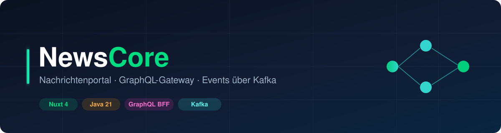
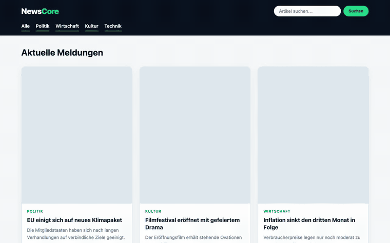
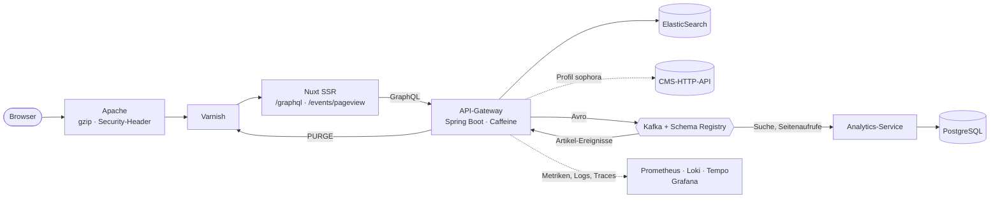

<h1 align="center">NewsCore</h1>

<p align="center">
  
</p>

<p align="center">
  <a href="https://github.com/AdrianDeutsch/newscore/actions/workflows/ci.yml"></a>
  
  
  
  
  <a href="LICENSE"></a>
</p>

<p align="center">
  
  <br>
  <em>Aufgenommen am laufenden Compose-Stack: Startseite → Ressort „Politik“ → Artikel → Suche nach
  „klima“ (auch als <a href="docs/images/hero-demo.mp4">MP4</a>).</em>
</p>

**NewsCore** ist ein Demo-Nachrichtenportal aus mehreren Diensten: ein server-seitig gerendertes
Nuxt-Frontend, ein GraphQL-Gateway in Spring Boot (Backend-for-Frontend), Volltextsuche in
ElasticSearch, Ereignisse über Kafka mit Avro und ein Analytics-Dienst in Node.js, der sie in
PostgreSQL schreibt. Davor sitzen Apache und Varnish, daneben Prometheus, Grafana, Loki und Tempo.
Die Inhalte sind acht Demo-Artikel; ein CMS-Adapter kann sie per Profil ersetzen.

Der ganze Stack startet mit einem Befehl. Die CI baut ihn, startet ihn und prüft ihn im Browser, in
der Datenbank, im Cache, in den Metriken und in den Traces.

| Ebene | Tests | Gegen |
|---|---:|---|
| Gateway, Unit | 76 | Mocks |
| Gateway, Integration | 16 | Spring-Kontext, ElasticSearch 8.18 (Testcontainers), EmbeddedKafka mit Mock-Schema-Registry |
| Frontend, Unit | 25 | Komponenten, Services, CSP-Berechnung, Datumsformat; gemockter GraphQL-Client |
| Analytics, Unit | 26 | gemocktes PostgreSQL und Schema Registry |
| Analytics, Integration | 5 | PostgreSQL 16 (Testcontainers) mit dem Schema des Stacks |
| Varnish | 2 Dateien | `varnishtest` mit Mock-Backend |
| Alarmregeln | 8 Fälle | `promtool test rules` |
| End-to-End | 28 (37 Läufe) | der komplette Compose-Stack, Chromium |

Alle Ebenen laufen in der CI bei jedem Push auf `main` und `develop`, bei jedem Pull Request und
einmal pro Woche.

---

## Inhalt

- [Was es zeigt](#was-es-zeigt)
- [Was das Nachmessen gefunden hat](#was-das-nachmessen-gefunden-hat)
- [Architektur](#architektur)
- [Schnellstart](#schnellstart)
- [Tests](#tests)
- [CI](#ci)
- [Projektstruktur](#projektstruktur)
- [Entscheidungen (ADRs)](#entscheidungen-adrs)
- [Grenzen](#grenzen)

## Was es zeigt

- **GraphQL-Gateway ohne N+1.** `author` und `category` werden für eine Artikelliste mit je einem
  Aufruf geladen (`@BatchMapping`). Ein Integrationstest zählt die Aufrufe.
- **Austauschbare Quellen per Spring-Profil.** In-Memory oder CMS-Adapter für Artikel, In-Memory oder
  ElasticSearch für die Suche, ohne Änderung an den Resolvern.
- **Ein Artikel-Ereignis hält alles aktuell.** Der CMS-Simulator (`POST /internal/cms/articles/{id}/update`)
  schreibt ein Ereignis nach Kafka. Der Consumer im Gateway leert die Caffeine-Caches, indiziert den
  Artikel in ElasticSearch neu und invalidiert Artikelseite und Startseite in Varnish. Suchindex und
  Varnish prüft die End-to-End-Suite, das Leeren der Caches ein Integrationstest mit eingebettetem
  Kafka (die Demo-Artikel ändern sich nie, im Stack ist das nicht beobachtbar).
- **Analytics ohne Datenverlust bei Ausfällen.** Vorübergehende Fehler führen zu erneuter Zustellung
  statt zum Verwerfen. Gespeichert wird idempotent über eine Ereignis-ID, die das Gateway vergibt
  ([ADR-013](docs/adr/ADR-013-analytics-zustellung.md)).
- **Der Browser kennt nur eine Origin.** GraphQL-Aufrufe aus dem Browser gehen an den Frontend-Server,
  der sie weiterreicht. Keine CORS-Freigabe; die CSP erlaubt Skripte nur von der eigenen Origin und
  per Hash, ohne `'unsafe-inline'` ([ADR-012](docs/adr/ADR-012-same-origin-und-csp.md)).
- **Fehler sind Fehler.** Ein fehlender Artikel antwortet mit 404, ein nicht erreichbares Gateway mit
  502 (Start, Suche, Artikel). Varnish speichert keine 5xx, 404 nur kurz.
- **Ein Trace über Kafka hinweg.** Mit `stack-full.env` ergibt eine HTTP-Anfrage an das Gateway
  zusammen mit dem Ereignis, das sie auslöst, einen Trace in Tempo. Die Logzeilen des Consumers tragen
  dieselbe `traceId` und sind in Loki darüber auffindbar.
- **Alarme, die auslösen können.** Jede Alarmregel hat einen `promtool`-Test. Ein End-to-End-Test
  prüft, dass das Gateway jede Metrik exportiert, die Regeln und Dashboard abfragen, und dass jede
  Serie einer Alarm-Metrik einen Zahlenwert hat.

## Was das Nachmessen gefunden hat

Vor diesen Änderungen war die CI grün, aber `docker compose up --build` aus diesem README schlug fehl,
und die CI hatte den Stack nie gestartet. Erst das Starten und Messen hat die folgenden Fehler
gezeigt. Jeder hat einen Bericht mit Ursache und den Test, der ihn jetzt abdeckt.

| | Befund | Bericht |
|---|---|---|
| 1 | Images bauen nicht mehr (Basis-Images geändert, Lockfile-Fehler durch `npm ci \|\| npm install` verdeckt) | [DEFECT-001](docs/defects/DEFECT-001-compose-build.md) |
| 2 | Cache-Invalidierung wirkungslos, dafür kann jeder von außen den Cache leeren | [DEFECT-002](docs/defects/DEFECT-002-cache-invalidierung.md) |
| 3 | Analytics-Service verwirft bei einem Datenbankausfall alle Ereignisse | [DEFECT-003](docs/defects/DEFECT-003-analytics-eventverlust.md) |
| 4 | Nach dem Spring-Boot-Update landen fehlerhafte Nachrichten im falschen Dead-Letter-Topic | [DEFECT-004](docs/defects/DEFECT-004-dead-letter-topic.md) |
| 5 | Ereignisse bleiben nach dem Start minutenlang unverarbeitet (Topic mit falscher Partitionszahl) | [DEFECT-005](docs/defects/DEFECT-005-topic-partitionen.md) |
| 6 | Hinter dem Proxy blockiert die CSP das Frontend; die Seite ist nicht bedienbar | [DEFECT-006](docs/defects/DEFECT-006-csp-edge.md) |
| 7 | Nicht vorhandener Artikel antwortet mit 200 und landet so im Cache | [DEFECT-007](docs/defects/DEFECT-007-artikel-404.md) |
| 8 | Uhrzeit hängt davon ab, ob Server oder Browser rendert | [DEFECT-008](docs/defects/DEFECT-008-zeitzone.md) |
| 9 | Health-Endpoint meldet DOWN, obwohl das Gateway läuft | [DEFECT-009](docs/defects/DEFECT-009-health-down.md) |
| 10 | Analytics verwirft nach einem Neustart neue Ereignisse als Duplikate (Fehler im eigenen Fix zu 3, von der unabhängigen Prüfung gefunden) | [DEFECT-010](docs/defects/DEFECT-010-idempotenzschluessel.md) |
| 11 | Start- und Suchseite antworten bei Gateway-Ausfall mit 200 und werden gecacht | [DEFECT-011](docs/defects/DEFECT-011-startseite-suche-200.md) |

Dazu Funde ohne eigenen Bericht: Die Helm-Variante der Alarmregeln war eine ältere Kopie mit vier
statt fünf Regeln; Tempo bekam im Compose-Stack nie einen Trace; der Cache stand nur vor der
In-Memory-Quelle, nicht vor dem CMS-Adapter; das Frontend-Image lief unter einem Benutzernamen statt
einer UID, was Kubernetes mit `runAsNonRoot` ablehnt; `npm audit` meldete 47 bzw. 18 Schwachstellen
(jetzt 0).

## Architektur



Gestrichelt: optional (Profil bzw. Compose-Profil). Begründung der Gateway-Schicht:
[ADR-002](docs/adr/ADR-002-graphql-bff-pattern.md).

## Schnellstart

Voraussetzung: Docker mit Compose.

```bash
docker compose up --build
```

- Frontend: <http://localhost:3000>
- GraphiQL: <http://localhost:8080/graphiql>

Der vollständige Stack, wie ihn die CI startet: Edge-Cache auf <http://localhost:8088>, Grafana auf
<http://localhost:3001>, JSON-Logs, Tracing und Cache-Invalidierung eingeschaltet:

```bash
docker compose --env-file stack-full.env --profile edge --profile observability up --build --wait
```

Ein Artikel-Ereignis auslösen, wie es ein CMS-Webhook täte:

```bash
curl -XPOST http://localhost:8080/internal/cms/articles/1/update
```

Die Dienste einzeln (Java 21, Node.js 24):

```bash
cd apps/api-gateway && ./mvnw spring-boot:run     # Standardprofil, ohne Infrastruktur
cd apps/frontend && npm install && npm run dev    # erwartet das Gateway auf :8080
```

Git-Hooks (Lint vor dem Commit, Commit-Format, Unit-Tests vor dem Push):

```bash
git config core.hooksPath .githooks
```

## Tests

```bash
cd apps/api-gateway && ./mvnw verify                          # Unit + Integration, 80-%-Grenze
cd apps/frontend && npm run test:unit -- --run --coverage
cd services/analytics-service && npm run test:unit -- --run --coverage && npm run test:integration
```

End-to-End gegen den laufenden vollständigen Stack (siehe oben):

```bash
cd e2e && npm ci && npx playwright install chromium && npm test
```

Die End-to-End-Suite ([`e2e/`](e2e/)) startet den Stack nicht selbst. Nur `gateway-down.spec.ts`
startet einen Hilfscontainer aus dem Frontend-Image des Stacks (braucht die Docker-CLI und Port 3099).
Die Suite prüft:

| Datei | Was |
|---|---|
| `ui.spec.ts` | die Wege eines Lesers im Browser, einmal direkt und einmal über Apache → Varnish; jeder Konsolenfehler lässt den Test scheitern |
| `events.spec.ts` | Suche und Seitenaufruf bis zur Zeile in PostgreSQL; ungültige Seitenaufrufe kommen dort nicht an |
| `search-index.spec.ts` | der Suchindex folgt Update-, Delete- und Publish-Ereignissen |
| `edge.spec.ts` | Cache-Treffer, Invalidierung durch Ereignisse, kein `PURGE` von außen, 404 auch über den Cache, Security-Header |
| `observability.spec.ts` | Health, exportierte Metriken mit Zahlenwerten, Prometheus-Ziele und -Regeln, Grafana-Provisioning, ein Trace über Kafka (inklusive PURGE-Aufrufen) in Tempo und seine Logzeile in Loki |
| `gateway-down.spec.ts` | ein zweites Frontend ohne erreichbares Gateway antwortet mit 502 statt 200 |

Die Bilder in diesem README erzeugt `npm run screenshots` im Ordner `e2e/` am laufenden Stack;
`./screenshots/render-demo.sh` macht daraus GIF und MP4 (braucht ffmpeg).

Tests mit Flakiness-Verdacht: [FLAKY-TESTS.md](FLAKY-TESTS.md).

## CI

[`.github/workflows/ci.yml`](.github/workflows/ci.yml), auf `main` und `develop`, bei Pull Requests,
wöchentlich und manuell:

| Job | Inhalt |
|---|---|
| `api-gateway` | `./mvnw verify` mit JaCoCo-Grenze, Checkstyle; Test- und Abdeckungszahlen in der Zusammenfassung des Laufs |
| `frontend` | Lint, Typprüfung, Unit-Tests mit Abdeckungsgrenze, SSR-Build |
| `analytics-service` | Lint, Unit-Tests mit Abdeckungsgrenze, Integrationstests gegen PostgreSQL, Build |
| `varnish` | `varnishtest` |
| `prometheus` | `promtool check rules` und `promtool test rules` |
| `helm` | `helm lint`, `helm template` für staging, prod und mit Monitoring |
| `e2e` | baut und startet den vollständigen Stack mit dem Befehl aus dem Schnellstart, dann die End-to-End-Suite |

[`.gitlab-ci.yml`](.gitlab-ci.yml) beschreibt einen Deploy-Pfad mit GitLab und ArgoCD. Er ist ein
Entwurf und wurde nie ausgeführt; die bekannten Lücken stehen am Anfang der Datei.

## Projektstruktur

```
newscore/
├── apps/
│   ├── api-gateway/          Spring Boot · GraphQL · ElasticSearch · Kafka   (eigene README)
│   └── frontend/             Nuxt · urql · SSR                                (eigene README)
├── services/
│   └── analytics-service/    Node.js · Kafka → PostgreSQL                     (eigene README)
├── e2e/                      Playwright gegen den Compose-Stack
├── infrastructure/           Apache, Varnish, Prometheus, Grafana, Loki, Tempo, Helm, ArgoCD
│                             (eigene README)
├── docs/
│   ├── adr/                  Architecture Decision Records
│   ├── defects/              Fehlerberichte
│   └── images/
├── docker-compose.yml
├── stack-full.env            Schalter für den vollständigen Stack
├── .github/                  CI, Dependabot, Vorlagen
└── .githooks/
```

## Entscheidungen (ADRs)

| ADR | Entscheidung |
|---|---|
| [ADR-001](docs/adr/ADR-001-graphql-client-urql.md) | urql als GraphQL-Client im Frontend |
| [ADR-002](docs/adr/ADR-002-graphql-bff-pattern.md) | GraphQL-Gateway nach dem BFF-Muster |
| [ADR-003](docs/adr/ADR-003-caffeine-caching.md) | Caffeine als In-Process-Cache |
| [ADR-004](docs/adr/ADR-004-elasticsearch-search.md) | ElasticSearch als Volltextsuche, per Profil |
| [ADR-005](docs/adr/ADR-005-kafka-eventing.md) | Kafka mit Dead-Letter-Topic (Serialisierung durch ADR-011 ersetzt) |
| [ADR-006](docs/adr/ADR-006-helm-argocd-gitops.md) | Helm-Chart und ArgoCD |
| [ADR-007](docs/adr/ADR-007-observability.md) | Prometheus, Grafana, Loki |
| [ADR-008](docs/adr/ADR-008-varnish-caching.md) | Varnish und Apache vor dem Frontend (Nachtrag: Ban statt Purge) |
| [ADR-009](docs/adr/ADR-009-distributed-tracing.md) | Tracing mit OpenTelemetry und Tempo |
| [ADR-010](docs/adr/ADR-010-sophora-cms-source.md) | CMS als austauschbare Artikelquelle (Nachtrag: eigener HTTP-Vertrag) |
| [ADR-011](docs/adr/ADR-011-avro-schema-registry.md) | Avro und Schema Registry |
| [ADR-012](docs/adr/ADR-012-same-origin-und-csp.md) | Browser nur gegen die eigene Origin, CSP per Hash |
| [ADR-013](docs/adr/ADR-013-analytics-zustellung.md) | Analytics: mindestens einmal zustellen, idempotent speichern |

## Grenzen

- **Kein Cluster.** Das Helm-Chart ist nur mit `helm lint` und `helm template` geprüft, nie
  installiert. Die ArgoCD-Applications zeigen auf ein Platzhalter-Repository. Lasttests gibt es nicht;
  die Zielwerte in ADR-008 (Antwortzeit, Trefferquote) sind nicht gemessen.
- **CMS-Adapter ohne CMS.** Der HTTP-Vertrag ist für dieses Projekt festgelegt und nur gegen einen
  Mock getestet, nie gegen eine Sophora-Installation.
- **Keine Authentifizierung.** Der CMS-Simulator unter `/internal/cms/**` ist über den Port des
  Gateways (8080) erreichbar.
- **Analytics:** keine Dead-Letter-Queue auf der Node-Seite, keine Metriken; kafkajs hat seit 2023
  kein Release mehr. Kein Migrationswerkzeug für das Schema: nach einer Schemaänderung
  `docker compose down -v`.
- **Lag-Alarm** misst auf Client-Seite; einen Consumer, der gar nicht mehr fetcht, sieht er nicht.
- **Suchseiten** werden nicht aktiv invalidiert (Varnish-TTL 30 s).
- **Abdeckung im Frontend** wird nur für Komponenten, Services und Hilfsfunktionen gemessen. Seiten,
  Plugins und Server-Routen laufen in der End-to-End-Suite, ohne Abdeckungsmessung.

## Lizenz

[MIT](LICENSE)
